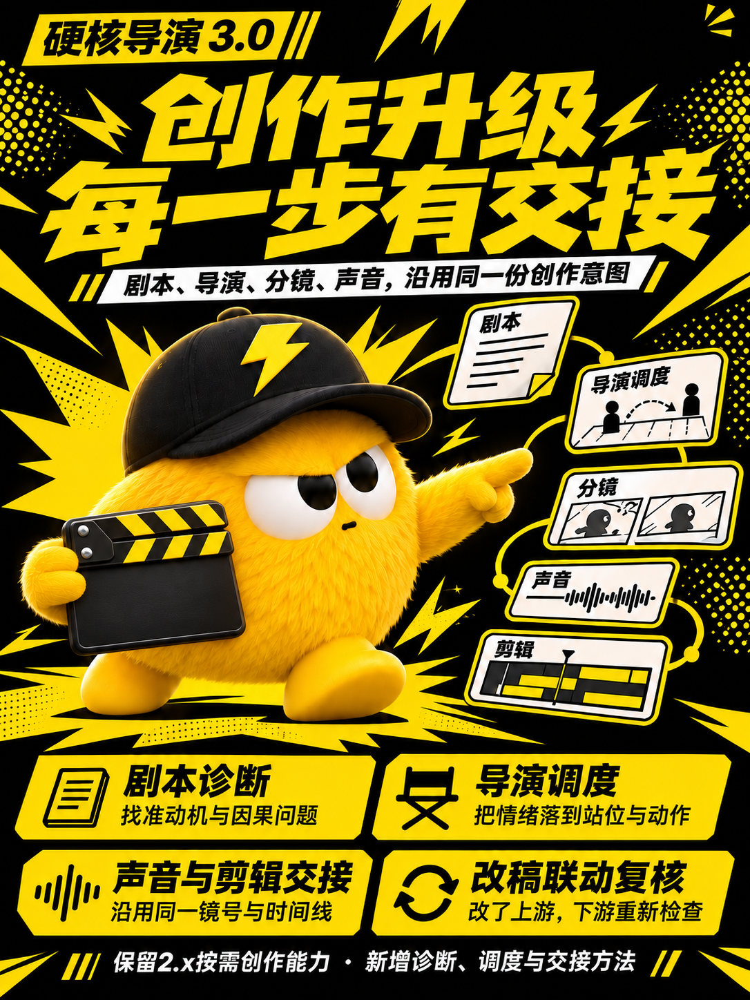

<p align="center"></p>

<h1 align="center">硬核导演 3.1 · Hardcore Director</h1>

<p align="center"><strong>电脑开着，你去忙。关键结果发到微信、飞书，确认后再继续。</strong></p>

<p align="center">
  
  
  
</p>

<p align="center"></p>

面向Codex等可运行本机命令的Agent，硬核导演把剧本、导演、分镜、平台提示词与实际制作接成同一条流程。2.x的按需创作继续保留；3.0加入持久任务记录、即梦画布执行、微信／飞书审核与合成，让电脑推进已获批准的任务，用户在手机处理关键决定。

3.1 新增[动画美术导演](references/integrations/animation-art-direction.md)。开分镜前先用一页简报定角色轮廓、强调色、各世界的画法和运动层次，再把需要保持或变化的规则落实到具体镜号。可参照[三镜双版本案例](references/support/animation-art-direction.example.md)。

## 3.0：一个自动工作流，电脑制作、手机把关

<p align="center"></p>

`需求 → 剧本/导演/分镜/提示词 → 确认方案与生图预算 → 微信或飞书逐镜审图 → 另批视频预算 → 逐镜生视频 → 规格检查与顺序合成 → 成片终审`

微信和飞书是这条工作流的审核通道。分镜图、成片和当前费用范围送到自己的机器人私聊。核对请求后回复“同意／拒绝”，有多项待审时先按提示选编号。工作流会等待当前阶段所需的内容、上传或费用批准。

电脑需要保持联网、唤醒，即梦登录与本机桥接、调度进程保持可用。首次接入由用户登录自己的账号、配置自己的机器人并完成本人绑定；接通后再用最小项目验证。它提供自动推进和人工审核，不承诺无需配置、无人参与或每秒推送进度。

## 创作模块也一起升级

<p align="center"></p>

- **剧本诊断**：定位具体场景、人物动机和因果问题，给出有依据的最小改单，交回编剧修订。
- **导演调度与表演**：把情绪落成站位、视线、动作、表演节拍与镜头覆盖，交给分镜执行。
- **分镜与产品镜头**：统一画幅、真实参考职责及首尾状态，补强“预备—动作—可读结果”的镜头表达。
- **声音与剪辑交接**：对白、环境声和音效沿用同一镜号、时间窗，传到视频提示词及后期计划。
- **改稿影响可追踪**：各阶段共享项目、角色、道具、对白和镜号；上游变化会使受影响交接过期，复核后再继续。

例如把“放下杯子”改为“递给对方”，导演动作、分镜道具归属、交接声与提示词都需要同步检查。创作模块产物成为下一阶段的依据，不各写一套故事。[创作协作链](references/integrations/creative-collaboration.md)与本地检查器负责核对来源、ID、时序、锁定状态、对白和声音引用；机器通过不代替故事、画面和听感验收。

3.0 新增四个创作方法适配和一个原创协作层，共 53 项顶层模块。3.1 加入动画美术导演，共 54 项。3.0 的组件来源与保留原因见[创作组件账本](audits/creative-components-v3.0-rc.7.md)。

## 从 1.0 到 3.1

<p align="center"></p>

| 版本 | 主要进步 |
| --- | --- |
| 1.0 | 汇集36份顶层能力模块，覆盖编剧、导演、分镜、视听风格与提示词等方法。 |
| 2.1 | 重写按阶段调用路径，加入Seedance 2.5、Wan 3.0、MiniMax H3提示词工具及新制作路径，建立来源与维护检查，形成45项能力。 |
| 2.2 | 升级中文润色、实拍剪辑、Seedance与配乐，加入产品镜头词典和分镜机器门禁，形成47项能力。 |
| 3.0 | 加入可恢复的自动制作工作流和微信／飞书审核，补强创作交接，让电脑推进、手机把关，形成53项能力。 |
| 3.1 | 加入动画美术导演，用全片锁定、分场变化与镜级例外把美术简报接到分镜和提示词，共 54 项能力。 |

历史依据：[1.0→2.1组件对账](audits/component-ledger-v1-to-v2.1.md)、[2.2升级记录](audits/upgrade-review-v2.2.md)。未给没有明确记录的版本补造迭代内容。

## 安装与第一次使用

当前正式版为 3.1.0，在审批与恢复修复的基础上增加动画美术导演。请从 [GitHub Release v3.1.0](https://github.com/jlam00-dev/hardcore-director/releases/tag/v3.1.0) 下载 Codex 完整包。包内保留品牌图片、海报、方法、脚本与使用手册。解压后安装完整 `hardcore-director` 文件夹。SkillHub 条目版本以平台页面为准。

Codex个人安装目录为`~/.agents/skills/hardcore-director`，应能找到其中的`SKILL.md`。装过2.x时先让Agent检查旧入口并保留可恢复备份，再安装 3.1.0；拿到新ZIP不会自动切换旧入口。不要只复制一个`SKILL.md`。[官方Skills说明](https://learn.chatgpt.com/docs/build-skills)

先读[新用户使用手册](references/support/user-guide.md)，也可下载[纯文字手册](references/support/user-manual.txt)。安装后新开会话，复制这一段开始：

```text
使用 $hardcore-director，带我完成第一次使用。
先确认实际加载的是3.1.0，检查包完整性与制作环境。
我先做一镜测试，使用自己的即梦画布账号，飞书或微信本人审核。
先给我方案和实时报价，内容、上传、生图和视频预算逐阶段确认后再继续。
```

只需创作时仍可按需调用：

```text
使用 $hardcore-director，把这个故事改成32秒短片。
先出剧本、导演处理、分镜和即梦提示词，暂不生成媒体。
沿用同一份人物、道具、对白和镜号，改稿时检查受影响环节。
```

也可单独写长短片剧本、做角色与场景、拆分镜、写指定平台提示词、拉片或做剪辑交接。默认按当前任务选择一个主模块、一个平台适配器与必要增强，不机械加载全部方法。

## 账号、费用和运行条件

详细步骤见[即梦、飞书与微信接入指南](references/support/remote-setup-guide.md)。

| 部分 | 需要准备 |
| --- | --- |
| 本机 | 可读取本地文件并运行命令的Agent、Python≥3.10；真实媒体检查与合成需ffmpeg/ffprobe。当前以macOS／支持POSIX权限和锁的环境为前提，原生Windows未验证。 |
| 即梦 | 官方`dreamina-canvas`、自己的profile与账号、明确的空间及专用画布、现场可用模型和资格。`dreamina`或浏览器登录不能代替画布CLI授权。 |
| 飞书 | 自己的企业自建机器人、三项最小权限、lark-oapi SDK与本人私聊配对。App ID/Secret由用户在本机终端输入。 |
| 微信 | 官方机器人二维码、自己的账号资格、核实后的本人稳定ID与审核白名单；媒体另需cryptography。不要求安装OpenClaw。 |

Skill、凭据与作品分别保存。用户的密钥、登录缓存、数据库与私人媒体不随包分发。首次设置完成后先做0费用收发和审核，再跑一镜真实生成。方案同意、素材上传、生图预算、视频预算与可选重编码分别核对；实际价格以官方当前节点报价为准，预算使用对应供应商的真实单位。

原操作ID和任务记录用于中断恢复。响应未知时先查询原任务，不盲目重新生成；更换账号、素材、修订、范围或预算后重新核验。回执“已记录”表示决定已入队，实际继续情况以本地工作流核验为准。

## 已验证范围与当前限制

| 能力 | 目前证据与边界 |
| --- | --- |
| 即梦＋微信 | 真实单镜的分镜审核、视频生成、回传和用户播放确认已有闭环；联调中有人工维护，不代表无需配置与维护。 |
| 飞书 | 既有真实图片／视频的收发、独立审核与用户播放确认已有实测；飞书审核后重新生成视频的完整Engine流程尚未证实。 |
| 两字审核 | 飞书“同意”、微信“拒绝”的0费用本人测试已入队并取得回执API确认；不据此宣称新媒体生成已执行。 |
| 多镜制作 | 驳回、恢复、预算及合成机制有离线／本地模拟验证；多镜真实付费闭环与《雨沿未拆》32秒完整成片仍未完成。 |
| 合成 | 逐镜生成视频后按已批准镜号顺序检查并拼接，再发成片终审。规格不兼容时暂停。可选统一规格须新批准并保留原片，新合成阶段的两端真人审核尚未实测。 |
| MiniMax Design | 支持能力检查、受限请求准备及另行授权的纯文字写入；缺少可靠账号核验、硬费用上限与媒体提交幂等保障，自动付费生成保持关闭。 |
| 自动剪辑与发布 | 顺序合成不等于自动选片、精细剪辑、混音或平台发布；这些需要独立工具、方案与授权。 |

证据按实际版本保留：[制作联调记录](audits/workflow-v3.0.md)、[两字审核记录](audits/short-reply-v3.0-rc.9.md)。正式版本标识不扩张既有验证范围，也不代表未测路径已通过。

## 硬仔IP与视觉

本版使用硬仔IP、黑底正黄及漫画3D视觉，默认角色空手，拍板等道具按场景选择。制作本品牌封面、海报、图标与手册图片时，先读[品牌视觉指南](references/support/brand-visual-guide.md)，使用随包资产，不回退到旧黑红视觉。Icon采用按需读取的打板喊Action形象；品牌素材不强加到用户自己的影片画面里。

## 维护与来源

```bash
python3 scripts/validate_package.py
python3 scripts/validate_storyboard.py references/support/storyboard-example.json --json
python3 scripts/check_updates.py --offline
python3 scripts/check_updates.py
```

离线检查包内哈希与引用，在线命令只读查询清单中配置的公开来源。没有独立公开版本的本机或原创模块做完整性与兼容检查，不虚构“全网最新”。维护报告区分可同步更新、上游待审阅、本地问题与来源失败；不会自动安装、覆盖、付费或发布。

模块与固定来源见[依赖清单](manifests/dependencies.json)，第三方条款见[来源与许可证说明](THIRD_PARTY_NOTICES.md)。原创部分采用MIT，第三方材料继续按各自许可使用；平台会员、软件许可和生成额度不包含在Skill内。
